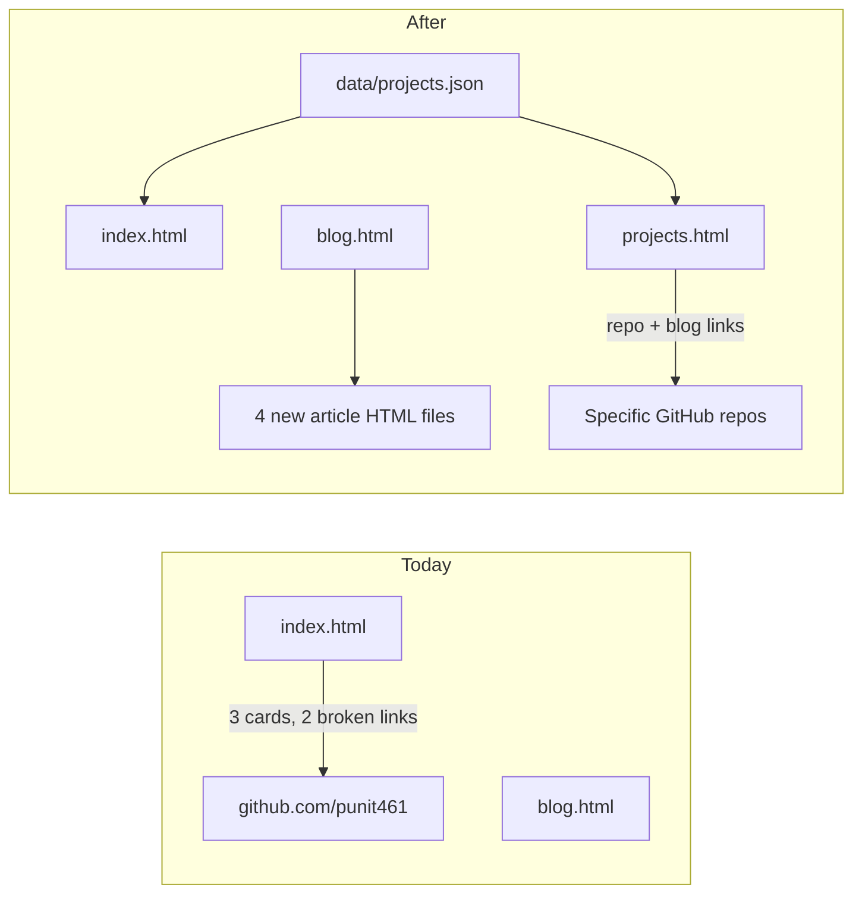
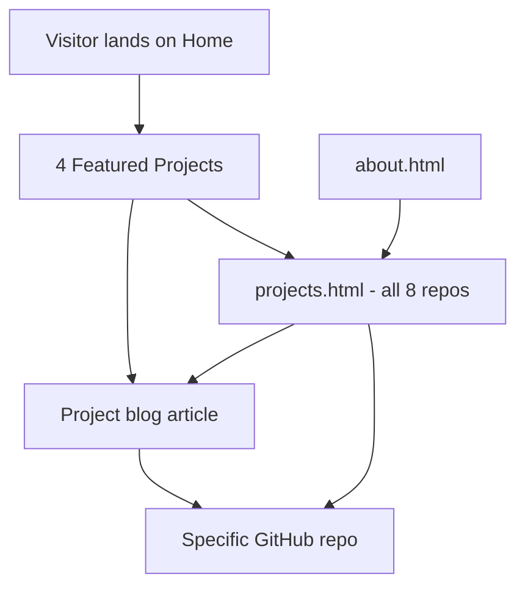

---
name: Portfolio Content Expansion
overview: Expand punit461.github.io with a dedicated Projects page, curated real GitHub repos (replacing placeholder profile links), and four new project-focused blog articles—while keeping the existing static HTML + GitHub Pages setup.
todos:
  - id: data-layer
    content: Create data/projects.json and data/blog.json with curated project and article metadata
    status: completed
  - id: site-js
    content: Add js/site.js to render project/blog cards from JSON into page containers
    status: completed
  - id: projects-page
    content: Create projects.html with category filters and full 8-project grid
    status: completed
  - id: update-home-nav
    content: Update index.html featured section + add Projects nav link across all pages
    status: completed
  - id: blog-articles
    content: Write 4 new project blog HTML files (ToolZoneX, SAM-3, Aura, AI-A2Z)
    status: completed
  - id: blog-index
    content: Update blog.html to render all 5 articles from blog.json
    status: completed
  - id: about-crosslinks
    content: Add Selected Projects section to about.html linking to repos and projects page
    status: completed
  - id: css-styles
    content: Add tag, filter-bar, project-links, and related-project styles to styles.css
    status: completed
  - id: mobile-navigation
    content: Add an accessible mobile hamburger navigation menu across the site
    status: completed
  - id: project-imagery
    content: Add GitHub repository preview images to every project card
    status: completed
  - id: site-discovery
    content: Add RSS feed, XML sitemap, and robots.txt for content discovery
    status: completed
  - id: jekyll-deployment
    content: Add Jekyll configuration and update GitHub Pages deployment to build the site
    status: completed
isProject: false
---
# Portfolio Content Expansion Plan

## Current State

Your site ([index.html](index.html)) is a **plain static HTML** GitHub Pages site with glassmorphism styling in [styles.css](styles.css). It currently shows:

- **3 featured projects** on the homepage — two link to your generic GitHub profile, not actual repos
- **1 published blog post** ([building-ai-agents.html](building-ai-agents.html)) + 1 "Coming Soon" placeholder
- **No dedicated Projects page**, no central content data, duplicated nav/footer across every HTML file

Your GitHub profile README lists projects (AI Agent Ecosystem, Smart Vision Suite) that **do not map to standalone repos**. Your real, portfolio-worthy work includes repos like `toolzonex`, `SAM-3-Professional-Annotation-Tool`, `Aura`, `Artificial-Intelligence-A2Z`, and `trialtreat`.



---

## Curated Projects (portfolio-worthy)

After reviewing your public repos, these **8 projects** will be featured (excluding old 2021 automation/test repos and meta repos like `punit461.github.io`, `punit461`, `portfolio`):

| Project                                      | Category                 | Link                                                                                                | Blog        |
| -------------------------------------------- | ------------------------ | --------------------------------------------------------------------------------------------------- | ----------- |
| **ToolZoneX**                          | Web App / Tools          | [toolzonex](https://github.com/punit461/toolzonex) + live site                                       | New article |
| **SAM-3 Professional Annotation Tool** | Computer Vision / ML     | [SAM-3-Professional-Annotation-Tool](https://github.com/punit461/SAM-3-Professional-Annotation-Tool) | New article |
| **Aura Email Assistant**               | AI Agents / Automation   | [Aura](https://github.com/punit461/Aura)                                                             | New article |
| **Artificial-Intelligence-A2Z**        | Learning / Education     | [Artificial-Intelligence-A2Z](https://github.com/punit461/Artificial-Intelligence-A2Z)               | New article |
| **TrialTreat**                         | Full-Stack / Marketplace | [trialtreat](https://github.com/punit461/trialtreat)                                                 | —          |
| **MachineLearningProjects**            | ML Collection            | [MachineLearningProjects](https://github.com/punit461/MachineLearningProjects)                       | —          |
| **Lilhakr Browser**                    | Side Project             | [Lilhakr_Browser](https://github.com/punit461/Lilhakr_Browser)                                       | —          |
| **Supercool Scripts**                  | Utilities                | [supercool_scritps](https://github.com/punit461/supercool_scritps)                                   | —          |

**Remove/replace** the current placeholder cards for "AI Agent Ecosystem" and "Smart Vision Suite" — they only link to your profile and have no repo backing.

---

## Architecture: JSON data + small JS renderer

Stay on **static HTML + GitHub Pages** (no Jekyll migration — keeps AdSense setup intact). Introduce a lightweight content layer:

### New files

- [data/projects.json](data/projects.json) — single source of truth for all project metadata (name, description, category, language, GitHub URL, live URL, blog slug, featured flag)
- [data/blog.json](data/blog.json) — blog index metadata (title, date, excerpt, slug, related project)
- [js/site.js](js/site.js) — vanilla JS to render project/blog cards into placeholder containers on `index.html`, `projects.html`, and `blog.html`

### Why this approach

- Adding a future project = edit one JSON entry, not 3 HTML files
- No build step required — works with your existing [.github/workflows/deploy.yml](.github/workflows/deploy.yml)
- Keeps the glassmorphism design system in [styles.css](styles.css)

---

## Page Changes

### 1. New [projects.html](projects.html)

- Hero intro: "Open-source work across AI, computer vision, and full-stack engineering"
- Category filter tabs: **All | AI/ML | Web Apps | Tools | Learning**
- Full grid of 8 project cards, each with:
  - Title, description, language badge, category tag
  - **View on GitHub** button (specific repo URL)
  - **Live Demo** button when applicable (ToolZoneX, TrialTreat if deployed)
  - **Read Blog** button when a related article exists

### 2. Update [index.html](index.html)

- Keep hero as-is (ToolZoneX CTA is strong)
- Replace "Featured Work" section: show **4 featured projects** (ToolZoneX, SAM-3, Aura, AI-A2Z) rendered from JSON
- Add "View All Projects" button linking to `projects.html`

### 3. Update [blog.html](blog.html)

- Render all articles from `blog.json` (existing AI agents article + 4 new ones)
- Remove the disabled "Optimizing RAG Pipelines" placeholder (or keep as a 5th future draft — your call during implementation)
- Group or tag posts by related project

### 4. Update nav on all pages

Add **Projects** link between About and Blog in every HTML file:

```
Home | About | Projects | Blog | ToolZoneX | Contact
```

Files to update: `index.html`, `about.html`, `blog.html`, `contact.html`, `privacy.html`, `terms.html`, `building-ai-agents.html`, plus 4 new article pages.

### 5. Update [about.html](about.html)

Add a short "Selected Projects" section with links to `projects.html` and the 4 major repos — connects your bio to concrete work.

---

## Four New Blog Articles (one per major project)

Each article follows the existing pattern in [building-ai-agents.html](building-ai-agents.html): shared nav/footer, inline article styles, ~800–1200 words, practical sections (problem, architecture, tech stack, lessons learned).

| File                               | Title                                                     | Focus                                                                                                    |
| ---------------------------------- | --------------------------------------------------------- | -------------------------------------------------------------------------------------------------------- |
| `blog-building-toolzonex.html`   | Building ToolZoneX: 100+ Calculators with Next.js and SSG | India-focused finance/health tools, Next.js 15, TypeScript, SEO via SSG, modular calculator architecture |
| `blog-sam3-annotation-tool.html` | Refactoring SAM 3 into a Production Annotation Tool       | Meta SAM 3 for dataset labeling, UI refactor, COCO export, VLA training workflows                        |
| `blog-aura-email-assistant.html` | Aura: Automating Outlook Drafts with AI                   | Fetching unread Outlook emails, LLM-powered draft generation, Python automation pipeline                 |
| `blog-ai-learning-a2z.html`      | Learning AI from Scratch: The A2Z Journey                 | Structured Jupyter-based curriculum covering ML, CV, and AI fundamentals                                 |

Each article will include a **"Related Project"** callout box linking to the GitHub repo and the project card on `projects.html`.

The existing [building-ai-agents.html](building-ai-agents.html) stays as general AI/agent content (not tied to a single repo).

---

## CSS Additions in [styles.css](styles.css)

Minimal new styles matching existing design:

- `.tag` / `.tag-ai`, `.tag-web`, etc. — category and language badges
- `.filter-bar` — category filter buttons on projects page
- `.project-links` — row of GitHub / Demo / Blog buttons
- `.related-project` — callout box in blog articles
- Slightly widen `main` max-width on `projects.html` to `1200px` for the larger grid

---

## Content Flow (how visitors discover your work)



---

## Follow-up Enhancements (implemented)

- **Jekyll migration:** GitHub Pages now builds the site with Jekyll using [_config.yml](_config.yml) and [Gemfile](Gemfile).
- **Mobile navigation:** Every page loads an accessible hamburger menu below 768px.
- **Project imagery:** Project cards use each repository's GitHub social-preview image, so no manually maintained screenshots are required.
- **RSS and sitemap:** [feed.xml](feed.xml), [sitemap.xml](sitemap.xml), and [robots.txt](robots.txt) support reader subscriptions and search discovery.
- **Shared site chrome:** Reusable Jekyll navigation and footer includes live in [_includes/](_includes/), ready for future page additions.

---

## Verification

After implementation:

1. Open site locally or on GitHub Pages — confirm JSON loads and cards render
2. Click every project card — each goes to a **specific repo**, not the profile
3. Confirm 5 blog posts appear on `blog.html` with working links
4. Check nav "Projects" link works from every page
5. Validate AdSense meta tags remain on all new pages
